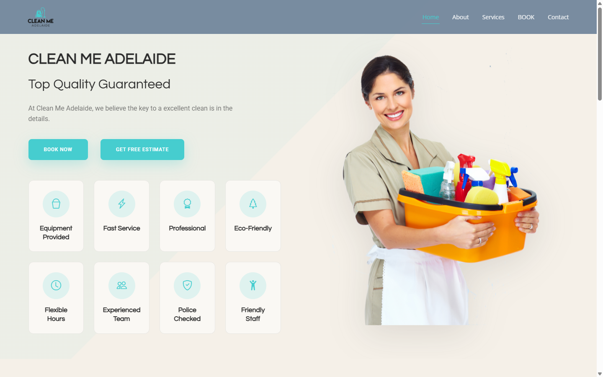
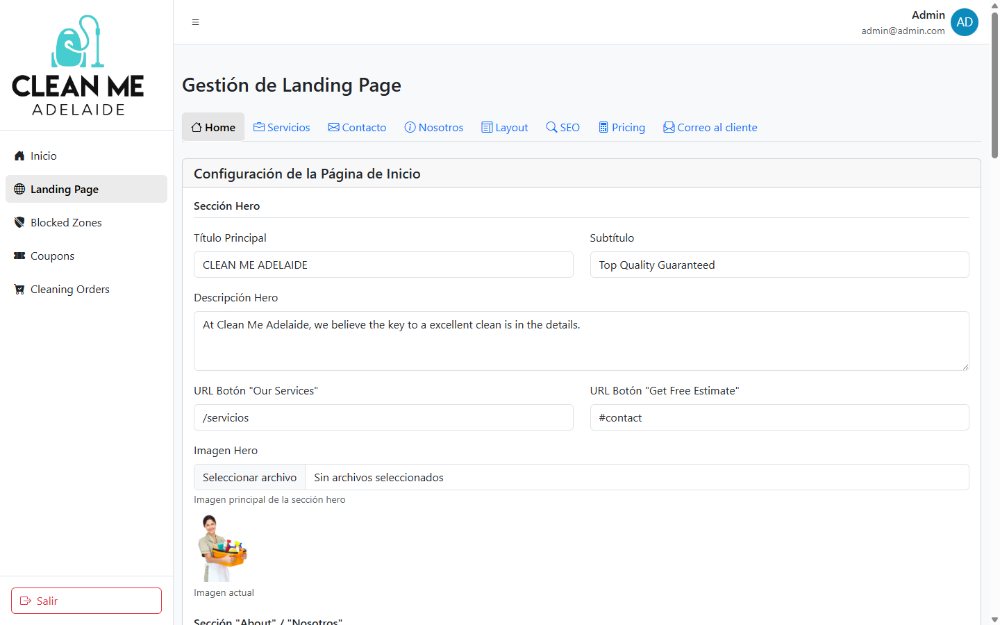
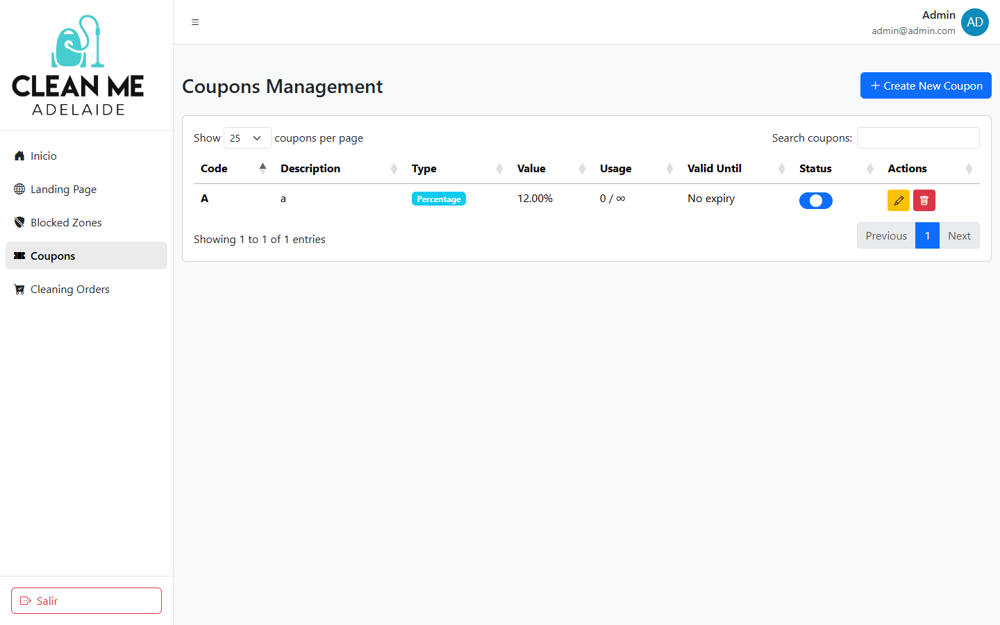

# Clean Me Adelaide — Landing con reservas y pagos en línea

Sitio web para una empresa de limpieza en Adelaide (Australia): landing autoadministrable, cotizador y reservas de servicio con pago en línea.



## Contexto

El cliente necesitaba un sitio en inglés que vendiera por sí solo: que el visitante pudiera cotizar el servicio según tamaño del inmueble, reservar fecha y hora, y pagar, mientras el equipo administra el contenido sin tocar código.

## Funcionalidades

- **Landing autoadministrable:** hero, servicios, *about*, testimonios, galería, precios, contacto y footer editables desde el panel.
- **Reservas de limpieza (Cleaning Orders):** tipo de servicio, metros cuadrados, fecha y hora con calendario, estados de pago y de orden.
- **Pagos en línea con Stripe.**
- **Cupones de descuento** por porcentaje o valor, con vigencia y límite de usos.
- **Zonas bloqueadas:** restringe direcciones fuera del área de cobertura (autocompletado de direcciones con Google Places).
- **Blog** con editor enriquecido (Quill) y **SEO avanzado:** meta tags, Open Graph, URL canónica y redirección a non-www.
- Panel administrativo con roles (admin / vendedor) y correos transaccionales.

## Stack

- **Backend:** PHP 8, Laravel 9, MySQL/MariaDB
- **Autenticación y permisos:** Laravel Breeze + spatie/laravel-permission (roles y permisos)
- **Frontend:** Blade, Livewire, Alpine.js, Tailwind CSS, Bootstrap, Flatpickr, Quill
- **Pagos:** Stripe (stripe-php)
- **Integraciones:** Google Places API

## Capturas

**Editor de la landing desde el panel**



**Gestión de cupones**



## Instalación local

Requisitos: PHP 8.0+ (con extensiones `gd`, `zip`, `intl`), Composer, Node 18+ y MySQL/MariaDB.

```bash
git clone <url-del-repositorio>
cd cleanme
composer install
npm install && npm run build
cp .env.example .env        # configura la conexión a la base de datos
php artisan key:generate
php artisan migrate --seed
php artisan serve
```

La aplicación queda disponible en `http://localhost:8000`. Los seeders crean los roles y datos iniciales (revisa `database/seeders`).

## Notas

- Proyecto desarrollado para un cliente real y desplegado en producción. Las capturas se tomaron en un entorno local; el historial de este repositorio se depuró para no incluir credenciales ni copias de bases de datos.

## Autor

**Santiago Bellaizán** — Desarrollador Full Stack (Laravel · PHP · MySQL · JavaScript)

- GitHub: [@Santibc](https://github.com/Santibc)
